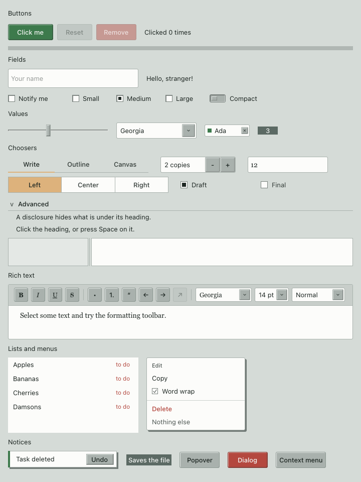
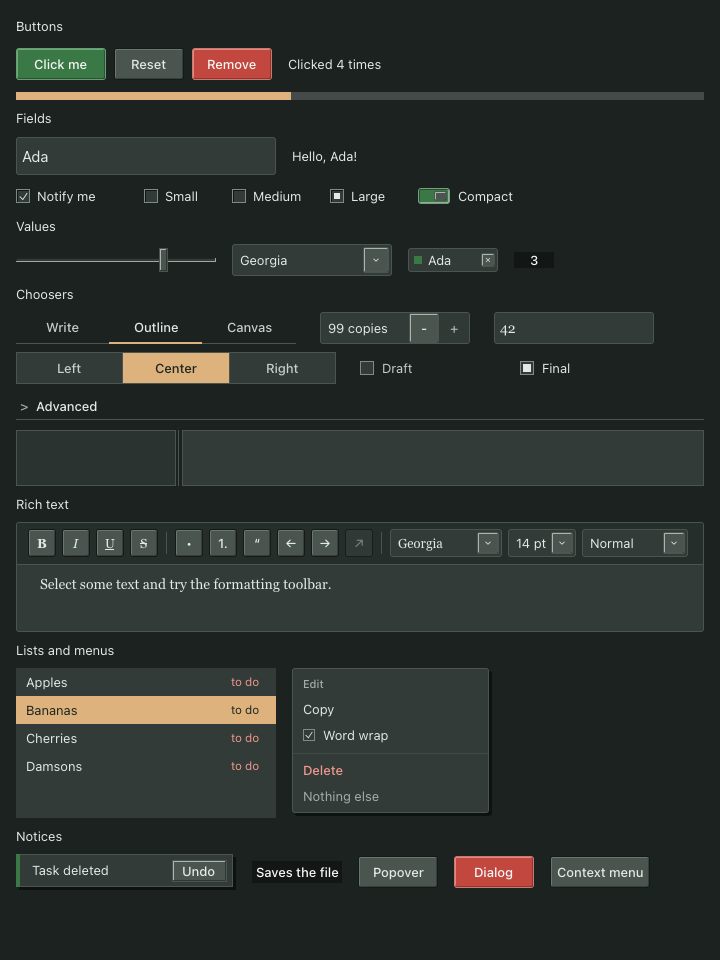
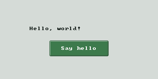

# Pomarine

Pomarine is an alpha GUI library for Ada on macOS. It provides widgets, layouts, themes, accessibility support,
and tools for building and testing applications.

## Gallery





## Hello, world!

This application displays a greeting and updates it when you click **Say hello**.



`tutorial/src/view_models/greeter_vm.ads`:

```ada
with Pomarine.View_Models;

--  The greeting and the command that changes it, independent of widgets.

package Greeter_VM is
   type Command is (Say_Hello);
   package Commands is new Pomarine.View_Models.Command_Models (Command);
   type Model is limited new Commands.Observed_Model with private;

   function Count (Self : Model) return Natural;
   function Message (Self : Model) return String;

   overriding
   function Can_Execute (Self : Model; What : Command; Index : Natural := 0) return Boolean;
private
   --  Private: run commands through Execute, which checks Can_Execute and counts the change.
   overriding
   procedure Perform (Self : in out Model; What : Command; Index : Natural := 0)
   with Post => Count (Self) = Count (Self)'Old + 1;

   type Model is limited new Commands.Observed_Model with record
      Greetings : Natural := 0;
   end record;
end Greeter_VM;
```

`tutorial/src/view_models/greeter_vm.adb`:

```ada
package body Greeter_VM is
   function Count (Self : Model) return Natural
   is (Self.Greetings);

   function Message (Self : Model) return String
   is (if Count (Self) = 0 then "Hello, world!" else "Hello again, x" & Count (Self)'Image & "!");

   overriding
   function Can_Execute (Self : Model; What : Command; Index : Natural := 0) return Boolean
   is (case What is
         when Say_Hello => Index = 0 and then Count (Self) < Natural'Last);

   overriding
   procedure Perform (Self : in out Model; What : Command; Index : Natural := 0) is
      pragma Unreferenced (Index);
   begin
      case What is
         when Say_Hello =>
            Self.Greetings := @ + 1;
      end case;
   end Perform;
end Greeter_VM;
```

`tutorial/src/greeter.ads`:

```ada
with Greeter_VM;
with Pomarine.UI;
with Pomarine.UI.Contexts;

--  A greeting and a command button, owned and synchronized by the view.

package Greeter is
   package UI renames Pomarine.UI;
   package Controls is new UI.Contexts (Greeter_VM.Commands, Greeter_VM.Model);

   Greeting : constant Controls.Text_Property := Controls.Showing (Greeter_VM.Message'Access);

   procedure Build (Screen : in out UI.View; Model : not null access Greeter_VM.Model);
   --  Model must outlive Screen.
end Greeter;
```

`tutorial/src/greeter.adb`:

```ada
with Pomarine.Widgets.Buttons;

package body Greeter is
   procedure Build (Screen : in out UI.View; Model : not null access Greeter_VM.Model) is
      Bound : constant Controls.Context'Class := Controls.Bind (Screen, Model);
      Whole : constant UI.Layout :=
        UI.Column
          ([Bound.Label (Greeting, Centered => True, Width => 200.0),
            Bound.Button
              ("Say hello",
               Greeter_VM.Say_Hello,
               Look      => Pomarine.Widgets.Buttons.Primary,
               Focusable => True,
               Width     => 120.0)],
           Align   => UI.Layouts.Center,
           Spread  => UI.Layouts.Center,
           Padding => 16.0,
           Gap     => 12.0,
           Grow    => 1.0);
   begin
      UI.Mount (Screen, Whole);
   end Build;
end Greeter;
```

`tutorial/src/first_app.adb`:

```ada
with Greeter;
with Greeter_VM;
with Pomarine.UI.Run_Window;

--  A greeting and a command button, declared with their model bindings in Greeter.

procedure First_App is
   procedure Show is new Pomarine.UI.Run_Window (Greeter_VM.Model, Greeter.Build);
   Model : aliased Greeter_VM.Model;
begin
   Show (Model, "My first app", 320, 160);
end First_App;
```

Build and run it from a recursive checkout of Pomarine:

```sh
cd tutorial
alr build
alr run first_app
```

See [Build your first Pomarine app](docs/getting-started.md) for prerequisites, setup, and a walkthrough.
Explore [examples](examples/) for more applications, [UI.md](UI.md) for the UI API, and
[TESTING.md](TESTING.md) for testing.

The [API reference](docs/api/index.html) is generated with GNATdoc. To regenerate it, install
`gnatdoc_bin` with Alire and run the following from the Pomarine directory:

```sh
alr exec -- gnatdoc -P pomarine.gpr -O docs/api
```
