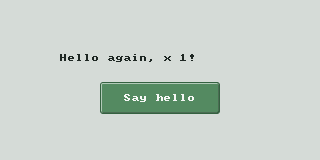

# Build your first Pomarine app

Build a window with a greeting and a **Say hello** button. The button runs a model command; the label updates
from the model. Tab and Return work too.




## Run the reference

You need macOS, Xcode Command Line Tools, Alire with an Ada 2022 GNAT compiler and GPRbuild, and SDL3 and
SDL3_image on the linker search path (Homebrew: `sdl3` and `sdl3_image`). CoreText ships with macOS; Yoga is
built from vendored sources.

```sh
git clone --recursive https://github.com/fncsftya/pomarine.git
cd pomarine/tutorial
alr build
alr run first_app
```

In Bonxie, initialize the submodules with `git submodule update --init --recursive`, then run the same commands
from `pomarine/tutorial`. Click the button, or press Tab then Return.

## Make your own copy

The complete reference is in [`tutorial/`](../tutorial/). To use it outside this checkout, copy it and put
Pomarine under `vendor/pomarine`:

```sh
mkdir -p first_app/vendor
cp tutorial/alire.toml tutorial/first_app.gpr first_app/
cp -R tutorial/src first_app/
cd first_app
git clone --recursive https://github.com/fncsftya/pomarine.git vendor/pomarine
```

In `alire.toml`, change each pin path from `..` or `../<crate>` to `vendor/pomarine` or
`vendor/pomarine/<crate>`, respectively. Pin the sibling crates at the application root so they resolve to the
same checkout. Run `alr build` and `alr run first_app`. The `capture` executable and `pomarine_testing`
dependency are only needed to regenerate the screenshots.

## Model and view

[`greeter_vm.ads`](../tutorial/src/view_models/greeter_vm.ads) declares the command, state queries, and
`Can_Execute`. [`greeter_vm.adb`](../tutorial/src/view_models/greeter_vm.adb) implements the greeting and
increments the count. The command is available only at index zero and while the count can increase;
`Perform` has a postcondition for the increment. `Observed_Model` tracks changes and rejects unavailable
commands. Keep application rules and persistence in the model, independent of widgets.

[`greeter.ads`](../tutorial/src/greeter.ads) instantiates `UI.Contexts` and exposes `Message` as a text
property. [`greeter.adb`](../tutorial/src/greeter.adb) binds that property and the command to a label and
button, then mounts the column:

```ada
UI.Column
  ([Bound.Label (Greeting, Centered => True, Width => 200.0, Height => 24.0),
    Bound.Button ("Say hello", Greeter_VM.Say_Hello,
                  Look => Pomarine.Widgets.Buttons.Primary,
                  Focusable => True, Width => 120.0, Height => 32.0)],
   Align => UI.Layouts.Center, Spread => UI.Layouts.Center,
   Padding => 16.0, Gap => 12.0, Grow => 1.0);
```

The view builds the layout once; bindings refresh when the model version changes. Button availability follows
`Can_Execute`. Layout dimensions are in points; the window supplies display density. Geometry, focus, painting,
and continuous gestures belong in the view.

[`first_app.adb`](../tutorial/src/first_app.adb) instantiates `Run_Window` with the model and `Build`.
The model must outlive the view; `Run_Window` manages the window, tree, and view in lifetime order. For more
control over those objects, see [UI.md](../UI.md).

## Test and capture

The reference's capture program builds the same view offscreen, checks the initial greeting, clicks the button
by semantic name, and checks the result. It paints both states with SDL's software renderer and saves PNGs:

```sh
cd pomarine/tutorial
alr build
alr run capture
```

The images are written to `pomarine/docs/images/`. For model contracts, keyboard interaction, and binding
checks, run the existing example test:

```sh
cd ../examples/tests
alr exec -- gprbuild -P todo_tests.gpr
bin/example_views_test
```

Test model rules without widgets, bindings through `Pomarine.Testing`, and drawing through goldens. See
[TESTING.md](../TESTING.md) for the test and image-review workflows. See [UI.md](../UI.md) and the gallery
(`alr run gallery_gui` in `examples/`) for more controls and bindings.
